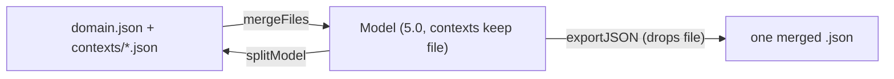

# Plan: a model splits into one file per Bounded Context

Implements [decision-00017](../decision/decision-00017-a-model-splits-into-one-file-per-bounded-context.md).
Terms follow [CONTEXT.md](../../CONTEXT.md).

The split is serialisation only. Everything that runs on a model - store, board,
health, Context Map, Focus, Isolate - keeps reading the one merged `Model`. Two
pure functions carry the whole format, and every surface (editor open, editor
save, the skill's validator) goes through them or their Python mirror:

## Acceptance criteria

Ids are this plan's; each row of the phases below names the ones it proves.

| Id | Given / When / Then |
|---|---|
| AC-1 | Given a domain file with no `file` link, when it is merged, then the result equals today's single-file import. |
| AC-2 | Given a domain file linking two contexts, when merged, then every node from a context file carries that context and every edge from every file is present, ids unchanged. |
| AC-3 | Given a merged model, when split and merged again, then the model is unchanged; each edge lands in the file the decision names (both ends in one linked context: its file; otherwise the domain file). |
| AC-4 | Given a context file whose node carries `context`, or a domain-file node naming a linked context, when merged, then the merge fails with a message naming the file and the node. |
| AC-5 | Given a `file` that is absolute, contains `..`, does not end `.json`, is shared by two contexts, or is missing from the folder, when merged, then the merge fails naming the context. |
| AC-6 | Given an id used in two files, when merged, then it fails naming the id. |
| AC-7 | Given two contexts joined by an edge and no Context Relationship in either direction, when health runs (editor) or the validator runs (skill), then `unbacked-seam` is reported once for that pair; with a relationship it is not; an edge with an Actor at either end is never a seam. |
| AC-8 | Given a split model folder, when opened in the editor through the folder input, then the board shows every element of every file. |
| AC-9 | Given a folder Project on Chromium, when saved, then `domain.json` and one file per context are written to the folder, and every context lacking a link gets `contexts/<id>.json`. |
| AC-10 | Given a folder Project, when Refresh runs, then the folder is re-read and merged as on open. |
| AC-11 | Given a model whose contexts carry links, when exported as one file, then the file has no `file` key and imports as a valid single-file model. |
| AC-12 | Given `validate.py domain.json` on a split model, then it reports the merged model's errors and warnings, each error naming the file it is in, with the same AC-4/5/6 failures as the editor. |
| AC-13 | Given the shipped split example, when validated and when opened in the editor, then it is clean and identical to its former single file. |

## Phase 1 - the format

| # | Task | Verify |
|---|---|---|
| P1.1 | `schema.ts`: optional `file` on `contextSchema`. (A separate `contextFileSchema` was dropped in implementation: `mergeFiles` checks the `{context, nodes, edges}` shape itself and the merged model goes through the full `modelSchema`, so a second node schema would only duplicate it.) | unit: shape accepted / rejected |
| P1.2 | New `lib/dsl/split.ts`: `mergeFiles(domainText, files: Record<path, text>) -> ImportResult` (link checks, membership, id uniqueness, then the existing migrate + schema path) and `splitModel(model) -> Record<path, text>`. Path checks in one helper. | unit split.test: AC-1..AC-6 |
| P1.3 | `serialize.ts` `exportJSON` drops `file` from every context. | unit: AC-11 |

## Phase 2 - model health

| # | Task | Verify |
|---|---|---|
| P2.1 | `health.ts`: `unbacked-seam`, warning, one per unordered context pair; `analyzeModel` takes `contextRelationships`; `health-panel.tsx` passes it. | unit health.test: AC-7 |

## Phase 3 - the editor

| # | Task | Verify |
|---|---|---|
| P3.1 | `source-file.ts`: `pickFolder()` (`showDirectoryPicker`, readwrite) and `readFolder(handle)` that collects `domain.json` plus every linked file; `writeFolder(handle, files)` that writes them. Fake directory handles in unit tests, as source-file.test does for files. | unit: AC-9, AC-10, permission denied and missing file map to the existing read failures |
| P3.2 | `ProjectSource` gains `kind: "file" \| "folder"` (absent = file, so stored Projects load). Refresh reads a folder source through `readFolder` + `mergeFiles`. | unit projects.test: an old record without `kind` still loads; AC-10 |
| P3.3 | Projects dialog: **Import folder** - a `webkitdirectory` input, works in every browser; the folder name names the Project. | e2e: AC-8 |
| P3.4 | File menu: **Save to folder** on Chromium - writes back to a folder source, or picks a folder and makes it the source; hidden where `showDirectoryPicker` is missing, where Export stays the way out. | unit (P3.1) for the write; e2e: the item is absent when the API is missing |

## Phase 4 - the skill

| # | Task | Verify |
|---|---|---|
| P4.1 | `validate.py`: when the model has links, follow them relative to the domain file, apply AC-4/5/6 with per-file messages, validate the merged model; `unbacked-seam` warning for single files too. | run on the split example (clean) and on broken copies, one per AC-4/5/6 (each error fires); AC-12 |
| P4.2 | `SKILL.md` rule 1 (one model grown in place; offer to split after the Context Map, then edit only the touched context's file), Output section; `dsl.md` layout section; `context-map.md` gate: every seam backed. | read against the decision |

## Phase 5 - example and glossary

| # | Task | Verify |
|---|---|---|
| P5.1 | `examples/ride-hailing/` replaces `examples/ride-hailing-event-storming.json`, produced by `splitModel` from it. Add any missing Context Relationship the new warning surfaces in the shipped examples, or record why not. | validator clean; the folder compared with the former file's model once, when it was produced (recorded in the acceptance record - the file is gone afterwards); a unit test keeps the folder exactly what `splitModel` writes for it: AC-13 |
| P5.2 | `CONTEXT.md`: **Domain File** and **Context File**. | review: glossary matches the decision |

## Out of scope

- Lazy loading one context at a time - the merged model is small at any size the
  examples reach.
- Deleting files of removed contexts; the editor never deletes files.
- Writing a folder on Firefox / Safari; Export of one merged file covers them.
- A per-file view in the UI; the existing Context Map, Focus and Isolate are the
  per-context views.

## Acceptance path

`resolved` only when, per [DEVELOPMENT.md](../../DEVELOPMENT.md) and CLAUDE.md §7:

- All phases done; `tsc`, `bun run lint`, `bun run build` clean; unit + e2e green;
  new code at 90% line / branch / function coverage.
- A subagent checks every AC above against a passing test or a recorded validator
  run, and the result is a `docs/record/` acceptance checklist.
